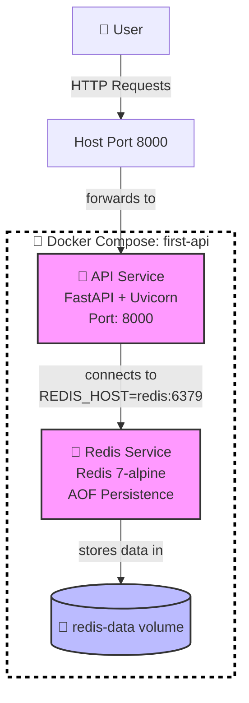

# Image Backend API

A FastAPI-based backend application with Redis persistence, featuring a Docker-themed landing page and RESTful endpoints. This project demonstrates modern Python web development with containerized deployment.

## 🚀 Project Overview

**Image Backend API** is a production-ready FastAPI application that:
- Serves a beautiful Docker-themed HTML landing page
- Provides RESTful API endpoints with health checks
- Implements a persistent counter using Redis
- Is fully containerized with Docker and Docker Compose
- Includes automatic API documentation via FastAPI

### Architecture



### Tech Stack

| Component | Technology | Version |
|-----------|------------|---------|
| Framework | FastAPI | >= 0.95.0 |
| ASGI Server | Uvicorn | >= 0.21.0 |
| Database | Redis | >= 5.0.0 |
| Runtime | Python | 3.14 (Docker) |
| Container | Docker | Latest |
| Orchestration | Docker Compose | Latest |

### 📊 Diagrams

For detailed visualizations of the application architecture, see the comprehensive Mermaid diagram file:

📄 **[`docs/architecture.mmd`](docs/architecture.mmd)** - Contains 7 detailed diagrams:

1. **Docker Compose Infrastructure** - Complete service and volume layout
2. **Application Request Flow** - Sequence diagrams for all endpoints
3. **System Architecture** - C4 Context level view
4. **Docker Network Architecture** - Network and port mapping
5. **Data Flow Diagram** - How requests flow through the system
6. **Endpoint Reference Card** - Quick visual reference for all API endpoints
7. **Deployment View** - Development vs Production setup comparison

> 💡 **Note**: These diagrams can be viewed directly in GitHub, GitLab, VS Code, or any Mermaid-compatible editor.

## ✨ Features

- **Landing Page**: Beautiful Docker-themed HTML interface
- **Health Check**: Comprehensive endpoint with uptime tracking
- **Redis Counter**: Persistent POST endpoint that increments and returns a global counter
- **Static Files**: Serves files from `/public` directory
- **Auto-Documentation**: Interactive API docs at `/docs` and `/redoc`
- **Docker Ready**: Production-ready container configuration

---


## 📋 Quick Start (Docker Recommended)

### Prerequisites

- [Docker](https://docs.docker.com/get-docker/) (v20.10+) installed
- [Docker Compose](https://docs.docker.com/compose/) (v2.0+) installed
- 500MB+ free disk space
- 512MB+ RAM available

### Option 1: Docker Compose (Recommended) ⭐

This is the **recommended** way to run the application as it automatically sets up both the API and Redis services.

```bash
# Clone and navigate to project
cd /path/to/first-app

# Build and start all services in detached mode
docker compose up -d --build

# View real-time logs
docker compose logs -f

# Check service status
docker compose ps
```

**Access the application:**
- 🌐 **Web UI**: http://localhost:8000
- 📊 **API Docs (Swagger)**: http://localhost:8000/docs
- 📖 **API Docs (ReDoc)**: http://localhost:8000/redoc
- 🔍 **Health Check**: http://localhost:8000/health

**Stop the application:**
```bash
docker compose down
```

### Option 2: Docker Only (Manual Setup)

If you want to run just the API container (Redis must be available separately):

```bash
# Build the API image
docker build -t image-backend-api .

# Run the container with environment variables
docker run -d \
  -p 8000:8000 \
  --name image-backend \
  -e REDIS_HOST=host.docker.internal \
  -e REDIS_PORT=6379 \
  image-backend-api

# View logs
docker logs -f image-backend
```

**Note**: You need Redis running on your host machine or another container.

---

## 🛠️ Development Setup (Without Docker)

For local development without containers:

### 1. Install Dependencies

```bash
# Create virtual environment (recommended)
python -m venv .venv
source .venv/bin/activate  # On Windows: .venv\Scripts\activate

# Install Python packages
pip install -r requirements.txt
```

### 2. Start Redis Server

You need Redis running locally:

**On Linux/macOS:**
```bash
# Install Redis (Ubuntu/Debian)
sudo apt update && sudo apt install redis-server
redis-server --daemonize yes --appendonly yes

# Or use Docker for Redis only
docker run -d -p 6379:6379 --name dev-redis redis:7-alpine redis-server --appendonly yes
```

**On Windows:**
- Install [Redis for Windows](https://github.com/tporadowski/redis/releases) or use WSL

### 3. Run the Application

```bash
# Development mode with auto-reload
uvicorn main:app --reload --port 8000

# Production mode (no auto-reload)
uvicorn main:app --host 0.0.0.0 --port 8000
```

**Access the application:**
- http://localhost:8000
- API Docs: http://localhost:8000/docs

---

## 🔌 API Endpoints

### GET /
Returns the Docker-themed landing page HTML.

**Request:**
```bash
curl http://localhost:8000/
```

**Response:** HTML page with Docker branding

---

### GET /health
Health check endpoint with system status and uptime.

**Request:**
```bash
curl http://localhost:8000/health
```

**Response:**
```json
{
  "status": "healthy",
  "message": "API is running",
  "timestamp": "2024-01-15T10:30:00.000000+00:00",
  "uptime": "0h 5m 23s",
  "version": "1.0.0",
  "service": "Image Backend API"
}
```

---

### POST /counter
Increments a global hit counter persisted in Redis and returns the current value.

**Request:**
```bash
curl -X POST http://localhost:8000/counter
```

**Response:**
```json
{
  "counter": 1,
  "timestamp": "2024-01-15T10:30:05.000000+00:00",
  "description": "Global request counter incremented by 1 (persisted in Redis)",
  "endpoint": "/counter",
  "method": "POST",
  "increment_by": 1,
  "storage": "redis"
}
```

**Notes:**
- The counter persists across server restarts (stored in Redis)
- Uses Redis INCR command for atomic increments
- Each POST request increases the counter by 1

---

### GET /docs
Interactive API documentation (Swagger UI) - Auto-generated by FastAPI.

---

### GET /redoc
Alternative API documentation (ReDoc format) - Auto-generated by FastAPI.

---

### GET /public/{filename}
Serves static files from the `/public` directory.

**Example:**
```bash
# Access the Docker Developer Guide PDF
curl http://localhost:8000/public/Docker_Developer_Guide_by_Dinesh.pdf
```

---

## 📁 Project Structure

```
first-app/
├── main.py                    # FastAPI application entry point
├── requirements.txt           # Python dependencies
├── Dockerfile                 # Container image configuration
├── compose.yaml               # Docker Compose orchestrator
├── README.md                  # This file
├── .gitignore                 # Git ignore patterns
├── docs/
│   └── architecture.mmd       # Mermaid architecture diagrams
├── templates/
│   └── index.html             # Landing page HTML template
└── public/
    └── Docker_Developer_Guide_by_Dinesh.pdf
```

---

## ⚙️ Configuration

### Environment Variables

| Variable | Default | Description |
|----------|---------|-------------|
| `REDIS_HOST` | `localhost` | Redis server hostname |
| `REDIS_PORT` | `6379` | Redis server port |
| `PYTHONUNBUFFERED` | `1` | Disable Python output buffering |
| `PYTHONDONTWRITEBYTECODE` | `1` | Prevent .pyc file creation |

### Docker Compose Configuration

The `compose.yaml` file defines:
- **api**: FastAPI application service (built from Dockerfile)
- **redis**: Redis 7-alpine service with AOF persistence
- **redis-data**: Named volume for Redis data persistence

---

## 🐳 Docker Details

### Dockerfile

The Docker image:
- Uses `python:3.14-slim` as base (lightweight)
- Installs dependencies from `requirements.txt`
- Sets up `/app` as working directory
- Exposes port 8000
- Runs with `uvicorn main:app --host 0.0.0.0 --port 8000`

**Build manually:**
```bash
docker build -t image-backend-api:latest .
```

**Run manually:**
```bash
docker run -d \
  -p 8000:8000 \
  -e REDIS_HOST=redis \
  -e REDIS_PORT=6379 \
  --name backend \
  image-backend-api:latest
```

### Image Tags

- **Latest**: `image-backend-api:latest`
- **With version**: `image-backend-api:v1.0.0`

---

## 🔄 Development Workflow

### With Docker Compose (Recommended)

```bash
# Start services
docker compose up -d

# View logs in real-time
docker compose logs -f api

# Run commands inside container
docker compose exec api bash

# Install new dependencies
# 1. Add to requirements.txt
# 2. Rebuild: docker compose up -d --build
```

### Hot Reload in Development

For development with auto-reload, modify the `CMD` in Dockerfile or use:

```bash
# Start with auto-reload
docker compose up api

# Or use compose override
echo "command: uvicorn main:app --reload --host 0.0.0.0 --port 8000" > compose.override.yaml
docker compose up -d
```

---

## 🧪 Testing the API

### Using curl

```bash
# Test landing page
curl -v http://localhost:8000/

# Test health check
curl -v http://localhost:8000/health

# Test counter (multiple times)
for i in {1..5}; do curl -X POST http://localhost:8000/counter; echo; done
```

### Using Python

```python
import requests

# Health check
response = requests.get("http://localhost:8000/health")
print(response.json())

# Increment counter
response = requests.post("http://localhost:8000/counter")
print(response.json())
```

---

## 📊 Monitoring

### Container Metrics

```bash
# View container resource usage
docker stats

# View logs
docker compose logs -f

# Check Redis memory usage
docker compose exec redis redis-cli info memory
```

---

## 🚨 Troubleshooting

### Common Issues

**1. Port 8000 already in use**
```bash
# Find and kill process on port 8000
lsof -i :8000
kill -9 <PID>

# Or change port in compose.yaml and Dockerfile
```

**2. Redis connection errors**
```bash
# Check if Redis is running
docker compose ps

# Test Redis connection
docker compose exec redis redis-cli ping
# Should return: PONG

# Check Redis logs
docker compose logs redis
```

**3. Docker build failures**
```bash
# Clean and rebuild
docker compose down -v
docker compose build --no-cache
docker compose up -d
```

**4. Python dependency issues**
```bash
# Recreate virtual environment
rm -rf .venv
python -m venv .venv
source .venv/bin/activate
pip install -r requirements.txt
```

---

## 🔧 Customization

### Adding New Endpoints

Edit `main.py` and add new route handlers:

```python
@app.get("/new-endpoint")
async def new_endpoint():
    return {"message": "Hello from new endpoint"}
```

### Adding New Dependencies

1. Add package to `requirements.txt`
2. Rebuild Docker image: `docker compose up -d --build`

### Changing Redis Configuration

Edit `compose.yaml` to change Redis image, ports, or persistence settings.

---

## 📄 Additional Resources

- [FastAPI Documentation](https://fastapi.tiangolo.com/)
- [Docker Documentation](https://docs.docker.com/)
- [Docker Compose Specification](https://docs.docker.com/compose/compose-file/)
- [Redis Documentation](https://redis.io/docs/)

### Included Resources

- **Docker Developer Guide**: [public/Docker_Developer_Guide_by_Dinesh.pdf](public/Docker_Developer_Guide_by_Dinesh.pdf)
  - Comprehensive Docker guide created by Dinesh
  - Covers Docker essentials for developers

---

## 🤝 Contributing

1. Fork the repository
2. Create a feature branch (`git checkout -b feature/amazing-feature`)
3. Make your changes
4. Test thoroughly
5. Commit your changes (`git commit -m 'Add amazing feature'`)
6. Push to the branch (`git push origin feature/amazing-feature`)
7. Open a Pull Request

---

## 📜 License

This project is open source and available under the [MIT License](LICENSE).

---

## 📞 Support

For issues or questions:
- Check the [Troubleshooting](#-troubleshooting) section above
- Review the Docker Developer Guide in the public folder
- Open an issue in the repository

---

*Built with ❤️ using FastAPI, Docker, and Redis*
